# UI/UX audit L2Points

Datum: 29. 10. 2026 · Větev: `feature/my-week-tables` (commit `55ce354`) · Rozsah: jen analýza a doporučení, nic neimplementováno.

## Souhrn

Glass UI je ve velkém hotové dobře. Tokeny `--l2p-*` drží většinu barev a skoro všechny texty mají kontrast nad 4,5:1 v obou režimech i nad září. Blur je jen na kartách, app baru a draweru. Zamčené buňky mřížky mají srozumitelný stav (čárkovaný okraj, zámek, legenda). Hlavička tabulek je všude stejný pruh.

Problémy jsou soustředěné ve čtyřech oblastech:

1. **Přístupnost ovládání.** Klávesnicový focus na icon buttonech a odkazech v navigaci je prakticky neviditelný (jen 6% tónování pozadí). Dotykové cíle na mobilu jsou pod 40 px, které chce spec, i pod 44 px podle skillu: zaškrtávátka v mřížce 36 px bez mezery, šipky týdne 32 px, výběr dne 27 px, admin akce 26 px.
2. **Okrajové kontrasty.** Stav, kdy aktuální týden je „Tento týden“ (neaktivní tlačítko), má 2,24:1 (dark) a 1,86:1 (light) a je na každé stránce. Tónové štítky a čárka na zvýrazněném řádku „já“ nad září klesají na 4,17 až 4,45:1. Barvy MudBlazor mimo tokeny (Info, Success, Secondary) jsou v jednom z režimů pod limitem.
3. **Nejednotná hierarchie a formáty.** Existují tři styly nadpisů sekcí a stránky nemají `<h1>` (titulky jsou `<h4>`). Body se ukazují jako „1450“ i „1 450“. Procenta jsou jednou tónová, jindy holý text. Uživatelská stránka Body ukazuje časy v UTC.
4. **Chybí sjednocený systém tokenů pro rozměry.** Spacing má 16 různých hodnot. Radiusy mají kromě škály 12/10/8/6 také 4 px (tlačítka a dialog z výchozího MudBlazor), 3,2 px a 9 px. Písmo má 12 velikostí včetně 11,2 px. Stín je jen jeden a dialogy používají Material elevaci místo skla.

Druhá polovina reportu navrhuje úpravu `--l2p-*`, která všechny tyto body pokrývá. Každá navržená barva je přepočítaná na kontrast (viz [Kontrasty](#kontrasty-namerene-a-spocitane)).

## Metodika

- **Skill ui-ux-pro-max 2.5.0.** V sezení nebyl registrovaný jako skill, proto jsem `SKILL.md` četl přímo z cache pluginu a spustil jeho `search.py`:
  - `--design-system "gaming guild dashboard dark glassmorphism"` dal styl Dark Mode (OLED), stavové barvy a „data-dense but scannable“. Typografii navrhl Orbitron + JetBrains Mono, což pro tuto appku nedoporučuji (viz Typografie).
  - Domény `style "glassmorphism dark"`, `ux` (tabulky/mobil, kontrast/focus/touch, loading/empty), `typography` (dashboard data), `chart` (KPI, ranking, progress), `color "gaming dashboard dark"` a `--stack html-tailwind`.
  - Pravidla v nálezech odkazují na kódy z Quick Reference skillu (např. `color-contrast`, `touch-target-size`).
- **Kód.** Prošel jsem `wwwroot/app.css`, `Layout/MainLayout.razor`, `AppTheme.cs`, všechny `*.razor.css` a markup stránek a komponent.
- **Živá aplikace** na `http://localhost:5167`, přihlášený admin:
  - Stránky: `/`, `/week`, `/leaderboard`, `/players/{id}`, `/jewels`, `/points`, `/profile`, `/admin`, `/admin/players` (včetně dialogu Upravit), `/admin/attendance`, `/admin/activities`, `/admin/schedule`, `/admin/settings`, `/admin/jewels`.
  - Velikosti a režimy: 1440×900 dark i light, 375×812 dark i light.
- **Měření kontrastu.**
  - Skript v prohlížeči (transitions a animace vypnuté) skládal skutečné pozadí od `html`: základ, obě radiální záře podle pozice prvku ve viewportu a pak `background-color` a `background-image` všech předků včetně `color-mix()`.
  - Každý viditelný text jsem změřil dvakrát: na jeho místě a v „nejhorším případě“ nad vrcholem záře vpravo dole. Pozadí je `fixed`, takže při scrollu tam může doputovat jakýkoli řádek.
  - Výsledky ověřuje nezávislý výpočet v Pythonu (tabulka níže). Model sedí s měřením: 4,20 vypočteno proti 4,22 naměřeno.
- **Neověřeno živě:**
  - `/login`: přihlášeného přesměruje. Hodnoceno z kódu a z `/profile`, která má stejné styly `account-*`.
  - Pohled Mřížka na `/week` a fallbacky `prefers-reduced-transparency` a `@supports not (backdrop-filter)`.

## Top 10 priorit

| # | Nález | Kde | Závažnost |
|---|---|---|---|
| 1 | Neviditelný focus u icon buttonů a odkazů v navigaci (jen 6% pozadí, `outline: none`) | celá appka, MudBlazor výchozí | vysoká |
| 2 | Zaškrtávátka v mřížce 36×36 px a pod sebou bez mezery (spec ≥ 40, skill ≥ 44) | `WeekGridView.razor.css:358` | vysoká |
| 3 | `/admin/players` na mobilu: akce schované za vodorovným scrollem, 7 ikon 26×26 px, mazání hned vedle úprav | `AdminPlayers.razor:84` | vysoká |
| 4 | Neaktivní „Tento týden“ / „Vrátit“: 2,24:1 (dark), 1,86:1 (light), vidět na každé stránce s týdnem | `WeekNavigator.razor:10` | vysoká |
| 5 | Stránky nemají `<h1>`, titulek je `<h4>`, sekce střídají `<h2>`/`<h5>`/`<h6>` | všechny stránky | vysoká |
| 6 | Tónové štítky a „–“ na řádku „já“ nad září: 4,17 až 4,45:1 | `RankingTable.razor.css:74`, `app.css:782` | střední |
| 7 | Dotykové cíle na mobilu pod 44 px: šipky týdne 32, výběr dne 27, přepínač Karty/Mřížka 28, nick odkazy 18 px | `WeekNavigator.razor.css:39`, `WeekOverview.razor.css:19` | střední |
| 8 | Barvy MudBlazor mimo tokeny: Info 3,55:1 (dark), Success 4,43 a Secondary 4,34:1 (light) | `AppTheme.cs:29–75` | střední |
| 9 | Nejednotná hierarchie a formáty: tři styly nadpisů sekcí, „1450“ proti „1 450“, procenta s tónem i bez, časy v UTC na `/points` | viz Přehlednost | střední |
| 10 | Bez škály rozměrů: 16 spacing hodnot, 12 velikostí písma (11,2 px), radiusy 4/3,2/9 px mimo škálu, dialog v Material stylu | viz Rytmus, Radiusy, Hloubka | střední |

## Nálezy po oblastech

Formát nálezu: **ID – název** (závažnost · režim), pak místo, co je špatně, návrh a odkaz na pravidlo. „Skill“ znamená kód z Quick Reference ui-ux-pro-max, „CLAUDE.md“ sekci Konvence.

### A. Barevná paleta a kontrast

**Stav:** opraveno v `feature/ui-audit`: A1–A8. A9 (pruh bodů) zůstává beze změny podle auditu.

**A1 – Neaktivní tlačítka čitelná na 2:1** (vysoká · dark, light, mobil)
- Kde: `Components/Attendance/WeekNavigator.razor:10-12` („Tento týden“ s `Disabled="@IsCurrentWeek"`), tlačítko „Vrátit“ v `/admin/schedule`.
- Co je špatně: MudBlazor kreslí neaktivní text jako `rgba(255,255,255,.26)` (dark), resp. `rgba(0,0,0,.26)` (light). Naměřeno 2,24:1 a nad září 2,29:1 (dark), 1,86:1 (light). WCAG neaktivní prvky z limitu vyjímá, jenže tady jde o běžný stav: aktuální týden je výchozí na Můj týden, Týden, Přehled i Detailu hráče, takže uživatel skoro pořád vidí vybledlý „rozbitý“ prvek.
- Návrh:
  - V aktuálním týdnu tlačítko nevykreslovat (`visibility: hidden`, aby šipky neposkočily), nebo ho nahradit textem „aktuální týden“ v `--l2p-text-2`.
  - Globálně přidat token `--l2p-text-disabled` (dark `#8C88AE`, 3,82:1; light `#77738F`, 3,80:1) a promítnout ho do `PaletteDark.TextDisabled` / `PaletteLight.TextDisabled` v `AppTheme.cs`.
- Pravidla: skill `disabled-states`, `state-clarity`; CLAUDE.md „kontrast aspoň 4,5:1“.

**A2 – Tónové štítky na zvýrazněném řádku „já“** (střední · dark, light)
- Kde: `Stats/RankingTable.razor.css:74-78` (řádek `l2p-rank-me`, primary 14 %), `Pages/WeekOverview.razor.css:221-229` (totéž v mřížce), `wwwroot/app.css:782-795` (štítky `.l2p-tone-*` s 16% výplní).
- Co je špatně: štítek leží na dvou vrstvách tónu nad sklem a září. Naměřeno dark `tone-low` 4,22:1 (Přehled, Týden). Spočteno light `tone-high` 4,17:1 a `tone-mid` 4,31:1, které se ukážou, jakmile má hráč ≥ 50 %.
- Návrh:
  - Tón řádku „já“ jako token `--l2p-row-me` na 10 % místo 14 %. Svislý proužek 3 px řádek dál jasně označuje.
  - Dark `--l2p-tone-low` `#FFA3A3` → `#FFB3B3`.
  - Light `--l2p-tone-high` `#06604E` → `#05594A`, `--l2p-tone-mid` `#714B00` → `#664400`.
  - Výsledné minimum na řádku „já“ nad září je 4,77:1 (dark), resp. 4,79:1 (light).
- Pravidla: skill `color-accessible-pairs`, `contrast-feedback`; CLAUDE.md (kontrast nad září).

**A3 – Tlumený text na hranici** (střední · light, dark)
- Kde: `RankingTable.razor.css:38` a `PlayerDetail.razor.css:31` (`.l2p-stat-empty` v `--l2p-muted`), token `app.css:89`.
- Co je špatně: „–“ na řádku „já“ má v light 4,45:1 na místě a 4,28:1 nad září. V dark má `--l2p-muted` na vnořené ploše nad září 4,51:1, tedy těsně nad limitem.
- Návrh: light `--l2p-muted` `#625D84` → `#58537A` (na řádku „já“ 5,26:1), dark `#A8A4CA` → `#AEAAD0` (vnořená plocha 4,83:1).
- Pravidla: skill `color-contrast`.

**A4 – Barvy MudBlazor mimo tokeny** (střední · dark, light)
- Kde: `Components/Layout/AppTheme.cs:29-75`, `/admin/schedule` (`MudAlert Severity.Info`), `/admin/players` (`AdminPlayers.razor:66`, `:76`, čipy `Color.Success` a `Color.Secondary`).
- Co je špatně:
  - `PaletteDark` nemá `Info`, takže platí výchozí `#0A85FF`. Text alertu má nad září 3,55:1 (naměřeno 3,72) a na vnořené ploše 2,97:1.
  - V light má čip „aktivní“ (Success `#0B7A63`) nad září 4,43:1 a čip „Super admin“ (Secondary `#c2410c`) 4,34:1.
  - Hexy v `AppTheme.cs` jsou kopie hodnot z `app.css` (primary, text, surface…). Je to druhý zdroj pravdy, který se snadno rozjede.
- Návrh:
  - Sémantické tokeny `--l2p-info|success|warning|danger` pro oba režimy: dark info `#7CC4FF` (6,84:1); light success `#086E59` (5,20:1) a secondary `#A93A0B` (5,34:1).
  - V `AppTheme.cs` ponechat stejné hexy s komentářem „zrcadlí `--l2p-*`“ a přidat test, který je porovná s `app.css` (podobně jako `JewelImageTests`).
- Pravidla: skill `color-semantic`, `dark-mode-pairing`; CLAUDE.md „Nové plochy a barvy bere UI z tokenů `--l2p-*`“.

**A5 – Štítky typu události v light** (střední · light)
- Kde: `Pages/WeekOverview.razor.css:76-99` (`.l2p-wk-kind`, barva = kategorie 60 % + text, výplň 16 %).
- Co je špatně: na vnořené kartě události nad září má „Večerní“ naměřeno 4,31:1, spočteno CS 4,44:1 a Ranní 4,53:1.
- Návrh: místo míchání v CSS zavést textové varianty kategorií `--l2p-cat-*-text`, použité přímo jako barva textu štítku. Jsou to barvy kategorie posunuté k barvě textu tak, aby štítek měl na vnořené ploše nad září aspoň 4,6:1:
  - dark: `normal` `#A5BFFF`, `evening` `#FCB375`, `morning` `#72CEF6`, `cs` `#61D6BF`;
  - light: `normal` `#2953AA`, `evening` `#8B4521`, `morning` `#1E5B95`, `cs` `#156360`.
- Pozor: samotné barvy kategorií jako text neprojdou (light Večerní `#E2690F` na své výplni jen 2,83:1), proto vlastní textové tokeny.
- Pravidla: skill `color-accessible-pairs`.

**A6 – Bronz v dark** (nízká · dark)
- Kde: `app.css:62` (`--l2p-place-3: #E0915A`).
- Co je špatně: na vnořené ploše nebo na řádku „já“ nad září 4,27 až 4,29:1. Nastane, když je třetím místem přihlášený hráč.
- Návrh: `#EBA06B` (4,99:1).

**A7 – Červená zeď nul** (střední · oba režimy)
- Kde: `Formatting/DisplayFormat.cs:24-30` (`PercentTone`: < 50 % = low), štítky v `RankingTable` (Přehled, Týden).
- Co je špatně: hráč bez účasti nebo začátek týdne znamená řádek pěti červených „0 %“ (viz screenshot 02). Červená je v UI signál chyby a tady převáží nad tím podstatným. Navíc „Normal 20 %“ v úterý je normální stav, ne alarm.
- Návrh:
  - 0 % jako neutrální štítek (`--l2p-muted`, bez výplně).
  - Pásma: high ≥ 80, mid 50–79, low 1–49.
  - Zvážit, aby se v aktuálním týdnu tónovalo až od středy, nebo jen sloupec Celkem.
- Pravidla: skill `color-not-decorative-only`; design system skillu („status colors… data-dense but scannable“).

**A8 – Natvrdo zadané barvy mimo tokeny** (nízká · oba)
- Kde:
  - `app.css:155-157` (`.validation-message #e50000`) a `app.css:160-173` (`#blazor-error-ui` `lightyellow`, `color-scheme: light only`): v dark svítí žlutý pruh.
  - `Layout/ReconnectModal.razor.css:93-115`: modrá `#6b9ed2`, `#3b6ea2`, `#0087ff` ze šablony, mimo značku.
  - Mix `--mud-palette-*` a `--l2p-*` v jednom souboru: `RankingTable.razor.css:47,82,91`, `WeekOverview.razor.css:72,125,152,199,232,237,242,248`.
- Návrh: všechno převést na `--l2p-*`. Chybové prvky na `--l2p-danger` a `--l2p-surface-solid`, reconnect modal na `--l2p-primary` a `--l2p-surface-solid`.
- Pravidla: skill `color-semantic`, „Raw hex in components“ (anti-pattern); CLAUDE.md tokeny.

**A9 – Pruh bodů** (nízká · dark)
- Kde: `RankingTable.razor.css:59-72`.
- Co je špatně: výplň primary proti stopě má jen 2,46:1 (dark). Hodnota je ale hned vedle číslem, takže pruh je doplňková informace a WCAG 1.4.11 se na něj nevztahuje.
- Návrh: ponechat. Pokud se bude ladit, stopu ztmavit v dark (`color-mix(text 7 %)`), nezesvětlovat.
- Pravidla: skill `contrast-data`, `direct-labeling` (splněno číslem).

Pozitivní: všechny ostatní páry text/plocha jsou v obou režimech nad 4,5:1, včetně textu na dnešní hlavičce (5,30 dark, 5,67 light) a `--l2p-primary-text` všude (≥ 5,04).

### B. Odsazení, rytmus a typografie

**Stav:** opraveno v `feature/ui-audit`: B1–B5.

**B1 – Spacing bez škály** (střední · všechny)
- Kde: `app.css`, všechny `*.razor.css`.
- Co je špatně: v CSS je 16 různých hodnot (0,15 · 0,2 · 0,25 · 0,3 · 0,35 · 0,4 · 0,45 · 0,5 · 0,6 · 0,65 · 0,75 · 0,9 · 1 · 1,25 · 1,4 · 1,5 rem) a k tomu utility MudBlazor (`mb-1`, `mb-2`, `mt-4`, `my-4`, `pa-4`). Stejná role má jinou mezeru: titulek sekce → karta 0,4 rem (`l2p-section-head`) proti 8 px (`mb-2` na `/points`) proti 0,4 rem (`l2p-grid-title`).
- Návrh: škála 4/8 px jako `--l2p-space-1..8` (viz Návrh tokenů) a pravidla rytmu:
  - pod titulkem stránky 24 px,
  - mezi sekcemi 32 px,
  - titulek sekce → karta 8 px,
  - uvnitř karty 16 px (mobil 12 px),
  - mezi kartami v mřížce 12 px.
- Pravidla: skill `spacing-scale`, „Section spacing hierarchy (16/24/32/48)“.

**B2 – Hlavička stránky pokaždé jinak** (střední · všechny)
- Kde: `MyWeek.razor:16` (`mb-1`), `Leaderboard.razor:21` (bez gutteru, v `l2p-lb-head`), ostatní `GutterBottom="true"` (0,35 em).
- Návrh: komponenta `PageHeader` (titulek, volitelné ovládání vpravo, pevná mezera 24 px pod ní). Na mobilu titulek 26–28 px místo 34 px: dnes zabírá zbytečně místa nad mřížkou.
- Pravidla: skill `visual-hierarchy`, `content-priority`.

**B3 – Typografická škála** (střední · všechny)
- Co je špatně (změřeno v DOM): 11,2 · 12 · 12,8 · 13 · 13,6 · 14 · 16 · 16,8 · 20 · 24 · 32 · 34 px. `.l2p-wk-kind` má 0,7 rem = 11,2 px (`WeekOverview.razor.css:80`), pod spodní hranicí skillu. Hodnoty KPI mají váhu 300 při 32 px (`app.css:686-694`), což je na skle v noci tenké a nad září to slévá tahy.
- Návrh:
  - Škála `--l2p-font-xs 12 / sm 13 / md 14 / base 16 / lg 18 / xl 20 / 2xl 24 / 3xl 32`.
  - Štítky min. 12 px.
  - Čísla v KPI váha 500–600, `tabular-nums` zůstává.
  - Font Outfit nechat. Návrh skillu Orbitron + JetBrains Mono je „cyberpunk/HUD“, se zbytkem UI nesedí a má horší čitelnost češtiny. Outfit je i v jeho seznamu („Geometric Modern“).
- Pravidla: skill `font-scale`, `weight-hierarchy`, „Text < 12px body“ (anti-pattern), `number-tabular` (splněno).

**B4 – Sloupce tabulek pod sebou nelícují** (střední · desktop)
- Kde: `/points` (`Points.razor`), `/admin/activities`.
- Co je špatně: každá tabulka (Normal, Chaotic, CS) má vlastní automatické rozložení, takže sloupec „Body“ a „Rozpis“ je v každé jinde (screenshot 04). Ranking tabulky to už řeší (`RankingTable.razor.css:3-20`).
- Návrh: stejný přístup, `table-layout: fixed` a sdílené šířky prvních sloupců (Název 14 rem, Body 6 rem).
- Pravidla: skill `whitespace-balance`; spec glass UI (sjednocený vzhled tabulek).

**B5 – Hustota tabulek** (nízká · desktop)
- Řádky 32–34 px (buňka 0,35 × 0,75 rem) jsou na desktopu vhodné a stejné ve všech tabulkách. Na dotykových zařízeních viz H4. Číslice jsou zarovnané (`tabular-nums`) a čísla vpravo, to je v pořádku.

### C. Ohraničení a radiusy

**Stav:** opraveno v `feature/ui-audit`: C1–C3 (C3: přilepené buňky mají jemný odstín `--l2p-surface-pinned` a stín až po posunu tabulky).

**C1 – Radiusy mimo škálu** (střední · všechny)
- Kde a co: škála ze specu 12/10/8/6 se dodržuje, ale vedle ní žijí:
  - 4 px u všech `MudButton` (výchozí MudBlazor), dialogu (`.mud-dialog`, naměřeno 4 px), `.l2p-legend-box` (`WeekGridView.razor.css:327`) a `.l2p-wk-kind` (0,25 rem),
  - 3,2 px u `.l2p-wk-meter` (0,2 rem),
  - 9 px u tracku přepínače,
  - 12 px u `account-button` (tlačítko jako karta) a 6 px u `account-error`.
- Návrh:
  - Tokeny `--l2p-radius-sm 6 / md 8 / lg 10 / xl 12 / full 999px`.
  - `MudTheme.LayoutProperties.DefaultBorderRadius = "8px"` (tlačítka, inputy, menu).
  - Dialog `--l2p-radius-xl`, štítky a meter `--l2p-radius-sm`, nebo `full` u tenkých pruhů, `account-button` `md`.
- Pravidla: skill `effects-match-style`, `elevation-consistent`; spec glass UI (sekce Sklo).

**C2 – Hrany a čáry: tři tokeny, pět použití** (nízká · dark)
- Kde: `--l2p-glass-edge` (karty, přilepené sloupce, `.l2p-wk-day`, `AdminJewels.razor.css:9` jako oddělovač řádků), `--l2p-divider` (řádky tabulek), `color-mix(primary 35 %)` (spodek hlavičky, ve třech souborech zvlášť).
- Co je špatně:
  - Řádky v `/admin/jewels` dělí hrana místo oddělovače, takže jsou výraznější než řádky tabulek.
  - V dark je hrana karty jen 1,18:1 proti pozadí a karta sama 1,09:1. V levém horním rohu bez záře se karty skoro ztrácejí, drží je jen stín.
- Návrh: pojmenovat role `--l2p-line-subtle` (oddělovač řádků), `--l2p-line` (hrana plochy, dark alfa 0,11 → 0,16, tedy 1,30:1; light 0,16 → 0,22) a `--l2p-line-strong` (spodek hlavičky, primary 35 %). Oddělovač v `/admin/jewels` přepnout na `line-subtle`.
- Pravidla: skill „Border and divider visibility“ (Light/Dark Mode Contrast).

**C3 – Přilepené buňky jako tmavé záplaty** (střední · dark, mobil)
- Kde: `app.css:621-629` (`.l2p-nick-cell` na `--l2p-surface-solid`), `WeekGridView.razor.css:66-78`, `WeekOverview.razor.css:203-214`, `PlayerDetail.razor.css:36-42`.
- Co je špatně: řádek tabulky je sklo nad září (≈ `#332A5E`), přilepený sloupec je neprůhledný `#16132A`. Na mobilu, kde záře pokrývá skoro celou obrazovku, působí sloupec nicků jako tmavá krabice mimo kartu (screenshot 09).
- Návrh:
  - Token `--l2p-surface-pinned` = `color-mix(in srgb, var(--l2p-primary) 10%, var(--l2p-surface-solid))` (dark ≈ `#22193F`), který rozdíl zmenší, ale zůstane neprůhledný.
  - Stín na pravé hraně jen při vodorovném scrollu (`box-shadow: 6px 0 8px -6px rgba(0,0,0,.35)`), aby přilepení vypadalo záměrně.
- Pravidla: skill `effects-match-style`; CLAUDE.md (přilepené buňky neprůhledné, zachovat).

### D. Stínování a hloubka

**Stav:** opraveno v `feature/ui-audit`: D1–D3.

**D1 – Dialogy v jiném jazyce než zbytek** (střední · oba)
- Kde: všechny `MudDialog` (`Components/Admin/*`), screenshot 06.
- Co je špatně: radius 4 px, Material elevace 24 (`0 11px 15px -7px …`), bez hrany. Karty mají 12 px, hranu a měkký stín.
- Návrh:
  - `.mud-dialog { border-radius: var(--l2p-radius-xl); border: 1px solid var(--l2p-line); box-shadow: var(--l2p-shadow-3); background: var(--l2p-surface-solid); }`.
  - Scrim dnes 50 % (`rgba(33,33,33,.5)`), což sedí do rozsahu skillu 40–60 %. Jen ho přebarvit do tónu pozadí: `color-mix(in srgb, var(--l2p-bg) 60%, transparent)`.
- Pravidla: skill `elevation-consistent`, `blur-purpose`, „Scrim and modal legibility“.

**D2 – Chybí škála elevace** (nízká · oba)
- Kde: `app.css:36,79` (jediný `--l2p-glass-shadow`). Popovery a menu mají výchozí MudBlazor elevaci 8.
- Návrh: `--l2p-shadow-1` (karta, dnešní hodnota), `--l2p-shadow-2` (popover, menu, tooltip), `--l2p-shadow-3` (dialog). Hodnoty v Návrhu tokenů.
- Pravidla: skill `elevation-consistent`.

**D3 – Blur na malých kartách** (nízká · mobil)
- Kde: KPI karty (`KpiCard.razor`, outlined `MudPaper`), karty stupňů vítězů, karty šperků.
- Co je špatně: naměřeno 9 prvků s `backdrop-filter` na `/leaderboard` (4 KPI + stupně + 2 tabulky + app bar + drawer) a 10 na `/jewels` (8 karet šperků). Spec povoluje blur na „kartách sekcí“, KPI a šperky jsou ale malé dlaždice v mřížce. Na slabším mobilu je to přesně anti-cíl ze specu („laguje při scrollu“).
- Návrh: dlaždice v mřížce (KPI, šperky, stupně) bez blur, s výplní `--l2p-glass-strong` nebo stejnou výplní jako karta. Blur nechat jen na kontejneru, ve kterém leží, nebo vůbec, pokud leží přímo na stránce. Třída `.l2p-tile` bez `backdrop-filter`.
- Pravidla: skill `blur-purpose` („not as decoration“); spec glass UI („Blur jen na velkých kontejnerech“).

Pozitivní: vnořené plochy blur nemají, popovery, menu a dialogy jsou neprůhledné, fallbacky pro `prefers-reduced-transparency` a chybějící `backdrop-filter` existují (`app.css:405-429`).

### E. Přehlednost a hierarchie

**Stav:** opraveno v `feature/ui-audit`: E1–E8.

**E1 – Sémantika nadpisů** (vysoká · přístupnost)
- Kde:
  - Titulky stránek jsou `MudText Typo="Typo.h4"`, takže se vykreslí `<h4>`: `MyWeek.razor:16`, `Leaderboard.razor:21`, `WeekOverview.razor:20`, `PlayerDetail.razor:41`, `Points.razor:11`, všechny admin stránky.
  - Sekce jsou jednou `<h2>` (`Leaderboard.razor:94,103`, `WeekOverview.razor:69,78`), jindy `<h5>` (`PlayerDetail.razor:53,75,106`) nebo `<h6>` (`Points.razor:33`, `AdminActivities.razor:37`, `AdminSchedule.razor:36,55`, `Jewels.razor:34`).
- Co je špatně: čtečka nemá `<h1>` a osnova přeskakuje úrovně (h4 → h2, h4 → h6).
- Návrh: titulek stránky `HtmlTag="h1"` (vzhled h4 může zůstat), sekce vždy `<h2>`, nadpisy karet (šperk, boss v rozpisu) `<h3>`. Nejlépe přes `PageHeader` a `SectionTitle`, aby se to nedalo splést.
- Pravidla: skill `heading-hierarchy`.

**E2 – Tři vizuální styly nadpisu sekce** (střední · všechny)
- Co je špatně:
  - `l2p-section-title` (16,8 px/600, s ikonou) na Přehledu a Týdnu.
  - h5 (24 px/400) na Detailu hráče.
  - h6 (20 px/500) na Body, Rozpisu a Aktivitách.
  - Na Detailu hráče jsou sekce větší než karta s body a hierarchie se obrací (screenshot 03).
- Návrh: všude `l2p-section-title` s ikonou (spec glass UI to tak definuje). Titulky tabulek mřížky (`l2p-grid-title`, 16 px/600) sloučit do stejné třídy.
- Pravidla: skill `consistency`, `visual-hierarchy`; spec glass UI (sekce Sklo: „nadpisy sekcí nad kartami mají před sebou ikonu“).

**E3 – Body bez oddělovače tisíců** (střední · všechny)
- Kde: `Attendance/WeekSummaryCard.razor:11` (`@Summary.Points`), `Stats/StatCells.razor:7` (`@Points`, historie na Detailu hráče). Jinde je `DisplayFormat.Points` („1 450“).
- Návrh: obojí přes `DisplayFormat.Points`. Volitelně test, který zkontroluje, že se `Points` v markupu nevypisuje holé.
- Pravidla: skill `number-formatting`.

**E4 – Procenta jednou tónová, jindy holá** (střední · oba)
- Kde: `PlayerDetail.razor:98` (`<StatCells … />` bez `Toned`), proti ranking tabulkám s `Toned`.
- Návrh: rozhodnout jeden styl. Historie je časová řada jednoho hráče, kde tón pomáhá najít slabý týden, tedy `Toned="true"`. Po úpravě A7 to nebude křičet.
- Pravidla: skill `consistency`.

**E5 – KPI kombinují jméno a čísla v jednom stylu** (nízká · oba)
- Kde: `Leaderboard.razor`, `WeekOverview.razor` („Hráč týdne: Linaya“ jako 32 px/300 v primary, je to odkaz).
- Co je špatně: jméno vypadá jako nadpis a odkaz není poznat, dokud na něj nenajedete.
- Návrh: hodnota jména 20–24 px/600 v `--l2p-text` s ikonou šipky nebo podtržením při focusu. Čísla podle B3.
- Pravidla: skill `visual-hierarchy`, `weight-hierarchy`.

**E6 – Časy v UTC na uživatelské stránce** (střední · oba)
- Kde: `Formatting/DisplayFormat.cs:122` (`ScheduleLabel`: „Týdně v sobotu 20:00 UTC“), použito na `/points` (všichni hráči) i `/admin/activities`.
- Co je špatně: CLAUDE.md říká „Časy se zobrazují v Europe/Prague“. Hráč by si UTC musel přepočítat sám.
- Návrh: na `/points` zobrazit pražský čas (např. „Týdně v sobotu 22:00“). Na `/admin/activities` stačí pražský čas s „(20:00 UTC)“ v závorce, jako to dělá `/admin/schedule`.
- Pravidla: CLAUDE.md Konvence.

**E7 – Texty a velká písmena** (nízká · oba)
- Kde:
  - `WeekOverview.razor:252` („průměrně 1 lidí na epic“): gramaticky špatně, lépe „průměrně 1 hráč na epic“ / „1,5 hráče“, nebo bez skloňování „hráčů na epic: 1“.
  - Tlačítka MudBlazor mají `text-transform: uppercase` (TENTO TÝDEN, NOVÝ HRÁČ, ULOŽIT ROZPIS, rozcestník Admin), zatímco zbytek UI má větnou velikost písmen.
- Návrh: `Typography.Button.TextTransform = "none"` v `AppTheme.cs:25`, váha 600.
- Pravidla: skill `consistency`, `letter-spacing`.

**E8 – Dnešní sloupec mimo obraz na mobilu** (střední · mobil)
- Kde: `WeekGridView` na Můj týden (screenshot 08).
- Co je špatně: na 375 px je vidět Boss + Po + Út. Od středy musí hráč pokaždé posunout tabulku doprava, aby zaškrtl dnešek, což je nejčastější akce aplikace.
- Návrh: po načtení na šířce < 600 px posunout `.l2p-grid-scroll` tak, aby dnešní sloupec byl hned za přilepeným sloupcem bossů (`scrollLeft` = pozice sloupce minus `--l2p-grid-boss-width`, bez animace).
- Pravidla: skill `content-priority`, `mobile-first`.

### F. Stavy (načítání, prázdno, chyba, zamčeno)

**Stav:** opraveno v `feature/ui-audit`: F1–F5.

**F1 – Načítání jako tenká čára na prázdné stránce** (střední · všechny)
- Kde: `MudProgressLinear … Class="my-4"` v 15 místech (`MyWeek.razor:32`, `Leaderboard.razor:33`, `PlayerDetail.razor:30`, `Points.razor:21`, `Jewels.razor:21`, všechny admin stránky).
- Co je špatně: prerender je vypnutý, takže každá navigace začne nadpisem a čárou a pak obsah „vyskočí“ (CLS). Přepnutí týdne už je dobře vyřešené (starý obsah zůstane a čára je přes hranu karty, `Leaderboard.razor.css:84-92`).
- Návrh: skeletony ve tvaru obsahu: 4 KPI dlaždice, hlavička a 5 řádků tabulky, 2 karty mřížky. `MudSkeleton` s výškami podle skutečných řádků (33 px), barva `--l2p-glass-strong`, a respektovat `prefers-reduced-motion` (bez vlnění).
- Pravidla: skill `progressive-loading`, `content-jumping`, `loading-states`.

**F2 – Prázdné stavy bez navigace a nejednotné** (střední · oba)
- Kde:
  - `/admin/attendance` a `/admin/jewels` bez `?player=`: jen select na prázdné stránce.
  - `PlayerDetail.razor:53` („Zatím žádný šperk.“ jako holý text) proti `:78` (`MudAlert Severity.Normal`).
  - `WeekOverview.razor:106` (text v `pa-4`), `Jewels.razor:40` („Zatím nikdo“).
- Návrh: komponenta `EmptyState` (ikona 24 px v `--l2p-muted`, věta, volitelná akce) ve všech těchto místech. V admin výběrech hráče text „Vyber hráče, kterému chceš opravit účast“ a seznam naposledy upravených hráčů.
- Pravidla: skill `empty-states`, `empty-data-state`.

**F3 – Mrtvé scoped CSS na `MudText`** (nízká · oba)
- Kde: `Jewels.razor.css:20-26` (`.l2p-jewel-total`, `.l2p-jewel-none`) a `MudText Class=…` v `Jewels.razor:40`. Scoped CSS na `MudText` nedosáhne (viz CLAUDE.md), pravidla se neuplatní.
- Pozor: `.l2p-jewel-none` míří na `--mud-palette-text-disabled` (1,9:1), takže kdyby se „opravilo“ prostým `::deep`, text spadne pod limit. Při úpravě použít `--l2p-muted`.
- Pravidla: CLAUDE.md (scoped CSS a MudBlazor komponenty).

**F4 – Nepřítomnost v mřížce Týden** (nízká · oba)
- Kde: `WeekOverview.razor:173` a `WeekOverview.razor.css:241-243` („·“ v `--mud-palette-text-disabled`, ≈ 1,9:1). Neověřeno živě, pohled Mřížka jsem neotevřel.
- Návrh: `--l2p-muted` a znak „–“, ať se kříží se „–“ ve statistikách.
- Pravidla: skill `color-contrast`.

**F5 – Chybové a reconnect UI mimo téma** (nízká · dark)
- Viz A8 (`#blazor-error-ui` žlutý, reconnect modal modrý).

Pozitivní: zamčený stav buňky (čárkovaný okraj, zámek v hlavičce, legenda) a jen čtecí mřížka bez vyblednutí jsou srozumitelné a odpovídají CLAUDE.md.

### G. Focus a přístupnost

**Stav:** opraveno v `feature/ui-audit`: G1–G4.

**G1 – Neviditelný focus** (vysoká · oba)
- Kde: všechny `MudIconButton` (app bar, šipky týdne, admin akce), `MudNavLink`, `MudButton`, `MudLink`. Při navigaci Tabem naměřeno `outline: none` a pozadí `rgba(79,74,110,.06)`.
- Co je špatně: uživatel s klávesnicí nevidí, kde je. Vlastní focus mají jen zaškrtávátko v mřížce (`WeekGridView.razor.css:250-253`), přepínač Karty/Mřížka (`app.css:763-767`) a inputy účtu.
- Návrh: jedno globální pravidlo s tokenem `--l2p-focus-ring` (= `--l2p-primary-text`, dark 6,09:1 a light 6,07:1 proti kartě nad září):
  ```css
  .mud-button-root:focus-visible, .mud-nav-link:focus-visible, a:focus-visible,
  .mud-chip.mud-clickable:focus-visible, .mud-switch-input:focus-visible + * {
      outline: 2px solid var(--l2p-focus-ring);
      outline-offset: 2px;
  }
  ```
- Pravidla: skill `focus-states`, `keyboard-nav`; UX doména „Focus States“ (High).

**G2 – Prázdné hlavičky sloupců** (nízká · přístupnost)
- Kde: `Stats/RankingTable.razor:12` (pořadí), `:17` (pruh bodů).
- Návrh: `<span class="mud-sr-only">Pořadí</span>`, resp. `aria-hidden` u sloupce pruhu.
- Pravidla: skill `voiceover-sr`.

**G3 – Účtové formuláře** (nízká · oba)
- Kde: `Account/Login.razor:23,29`, `Account/ChangePassword.razor`.
- Pozitivní: `autocomplete` je správně (`username`, `current-password`, `new-password`), labely jsou viditelné.
- Co chybí: přepínač zobrazení hesla a výška inputu 41 px (skill ≥ 44).
- Návrh: tlačítko oko v poli (44×44), `padding: 0.75rem`.
- Pravidla: skill `password-toggle`, `touch-friendly-input`.

**G4 – Omezení pohybu** (nízká · oba)
- Kde: `app.css` nemá `@media (prefers-reduced-motion: reduce)`. Neurčitý `MudProgressLinear` a ripple běží vždy.
- Návrh: v tom media query vypnout animace progressu (nahradit statickým pruhem 30 %) a ripple.
- Pravidla: skill `reduced-motion`.

### H. Dotykové cíle a mobil (375×812)

**Stav:** opraveno v `feature/ui-audit`: H1–H4 a H7. H5 (žebříček na mobilu) a H6 (spodní navigace) odloženo, viz roadmapa.

Naměřené velikosti interaktivních prvků pod 44 px:

| Prvek | Velikost | Kde |
|---|---|---|
| Zaškrtávátko v mřížce | 36×36, mezi V a R 0 px | `WeekGridView.razor.css:358-363` |
| Šipky týdne | 32×32 | `WeekNavigator.razor.css:39-41` |
| Tento týden | 108×31 | `WeekNavigator.razor:10` |
| Přepínač „Zobrazit neaktivní“ / Karty-Mřížka | 38×38, popisky 44×28 a 50×28 | `Leaderboard.razor`, `app.css:747-756` |
| Výběr dne | ~97×27 | `WeekOverview.razor.css:19-31,262-265` |
| Nick odkazy v tabulkách | ~45×18 | `PlayerNickCell.razor` |
| Admin akce hráče | 26×26 ×7 v řadě | `AdminPlayers.razor:84-110` |
| Položky draweru | 240×41 | `app.css:383-387` |
| Inputy účtu | výška 41 | `app.css:543-551` |

**H1 – Zaškrtávátka** (vysoká · mobil)
- Co je špatně: spec glass UI chce ≥ 40×40 px na mobilu, CSS dává 36. Dvě pole slotu pod sebou se dotýkají (0 px mezera), takže vedle sebe je 156 cílů.
- Návrh: na `(pointer: coarse)` 44×44 (padding 12 px kolem 20px rámečku) a mezi poli slotu 4 px. Řádek chaotic tím naroste z ~77 na ~96 px, což je přijatelné, protože mřížka je hlavní úkol.
- Pravidla: skill `touch-target-size`, `touch-spacing`; spec glass UI (Cíle).

**H2 – Admin hráči na mobilu** (vysoká · mobil, desktop)
- Co je špatně: akce jsou až za Login / Aktivní od / Stav / Admin, tedy za vodorovným scrollem (screenshot 11). Sedm ikon 26×26 px bez popisků. „Smazat“ je hned vedle běžných akcí.
- Návrh:
  - Na < 600 px seznam karet: nick a stav, pod tím tlačítka „Upravit“ a „Účast“ a menu „⋯“ (44×44) se zbytkem.
  - Na desktopu dvě nejčastější akce jako ikony 40×40 a zbytek v menu, „Smazat“ v menu oddělené čarou a v `--l2p-danger`.
- Pravidla: skill `touch-target-size`, `overflow-menu`, `destructive-emphasis`, `destructive-nav-separation`, UX „Table Handling“ (card layout).

**H3 – Navigace týdne, dny, přepínače** (střední · mobil)
- Návrh: na `(pointer: coarse)` minimální výška 44 px (šipky 44×44, „Tento týden“ výška 44, výběr dne `min-height: 44px` s mezerou 8 px, popisky Karty/Mřížka padding na 44 px).
- Pravidla: skill `touch-target-size`, `touch-spacing`.

**H4 – Řádek tabulky jako cíl** (střední · mobil)
- Návrh: nick odkaz přes celou buňku (`display: block`, výplň na výšku řádku). Na `(pointer: coarse)` řádky tabulek 44 px (padding 0,6 rem vertikálně).
- Pravidla: skill `touch-target-size`, `no-precision-required`.

**H5 – Žebříček na mobilu** (střední · mobil)
- Co je špatně: tabulka má `min-width: 34rem`, na 375 px jsou vidět jen Body a Celkem, čtyři kategorie jsou za scrollem a jejich existence není zřejmá.
- Návrh: na < 600 px ukázat pořadí, nick, body a Celkem. Kategorie dát do rozbalení řádku nebo na detail hráče (odkaz je v nicku). Alternativa: stín na pravé hraně scrolleru jako nápověda.
- Pravidla: skill `horizontal-scroll`, `content-priority`, UX „Table Handling“.

**H6 – Navigace na mobilu** (nízká · mobil)
- Co je špatně: hamburger s 7 položkami. Skill pro mobil doporučuje spodní lištu s ≤ 5 položkami s ikonou i popiskem pro top-level obrazovky.
- Návrh (volitelný, větší změna): spodní lišta Můj týden / Týden / Přehled / Šperky / Více (Body, Profil, Admin), drawer jen pro desktop. Dnešní drawer je jinak v pořádku: neprůhledný, scrim 50 %, aktivní položka zvýrazněná.
- Pravidla: skill `bottom-nav-limit`, `adaptive-navigation`, `nav-label-icon`.

**H7 – Rozpis: ořezaný placeholder** (nízká · desktop, mobil)
- Kde: `/admin/schedule`, pole 100 px s placeholderem „HH:mm UTC“, který se ořízne na „HH:mm U“ (screenshot 05).
- Návrh: placeholder „HH:mm“ a „UTC“ do labelu („Večerní (UTC)“), `inputmode="numeric"`.
- Pravidla: skill `input-type-keyboard`, `truncation-strategy`.

Pozitivní: žádná stránka na 375 px nemá vodorovný scroll celé stránky (`scrollWidth` = 375), široké tabulky scrollují uvnitř karty a přilepený sloupec funguje.

### I. Ikony a obrázky

**Stav:** opraveno v `feature/ui-audit`: I1 (ikony šperků v rámečku `--l2p-icon-tile`). I2 je jen pravidlo ve specu glass UI (Filled a Outlined ikony), bez změny kódu.

**I1 – Ikony šperků v light jako černé čtverce** (střední · light)
- Kde: `Jewels/JewelIcon.razor`, `PlayerNickCell.razor` (screenshot 07, Semtex).
- Co je špatně: PNG z l2j.ru mají tmavé pozadí zapečené v obrázku. V dark splynou, v light vypadají jako díra v tabulce.
- Návrh: ikonu vždy rámovat tokenem `--l2p-icon-tile` (dark `#1C1929`, light `#2A2545`), radius 6 px a 1px `--l2p-line`. Pak to je „herní slot“ v obou režimech záměrně. Ikony jsou herní assety, proto pravidlo skillu „vector-only“ se na ně nevztahuje.
- Pravidla: skill `dark-mode-pairing`, `icon-style-consistent`.

**I2 – Filled a Outlined ikony** (nízká)
- Navigace a admin akce používají Filled, nadpisy sekcí Outlined. Jsou to různé úrovně, takže je to obhajitelné. Stačí to zapsat do specu jako pravidlo (navigace a akce Filled, nadpisy Outlined).

## Návrh sjednocených tokenů

Úprava `wwwroot/app.css`. Barvy jsou přepočítané skriptem (viz Kontrasty), rozměry v px kvůli čitelnosti, v CSS je možné psát rem. Hodnoty, které se nemění, jsou vynechané.

```css
/* Theme-independent scales. */
:root {
    /* Spacing, 4/8 px grid. */
    --l2p-space-1: 4px;
    --l2p-space-2: 8px;
    --l2p-space-3: 12px;
    --l2p-space-4: 16px;
    --l2p-space-5: 24px;
    --l2p-space-6: 32px;
    --l2p-space-7: 48px;
    /* Rhythm by role. */
    --l2p-gap-title: var(--l2p-space-2);    /* section title -> card */
    --l2p-gap-tiles: var(--l2p-space-3);    /* tiles in a grid (KPI, jewels, podium) */
    --l2p-gap-section: var(--l2p-space-6);  /* between sections */
    --l2p-pad-card: var(--l2p-space-4);     /* 12 px below 600 px */
    --l2p-page-head: var(--l2p-space-5);    /* under the page title */

    /* Radius (the scale of the glass spec plus full). */
    --l2p-radius-sm: 6px;    /* badges, checkbox, legend box, focus ring */
    --l2p-radius-md: 8px;    /* buttons, inputs, chips, nav items, day picker (MudTheme DefaultBorderRadius) */
    --l2p-radius-lg: 10px;   /* nested surfaces, tiles */
    --l2p-radius-xl: 12px;   /* cards, dialogs */
    --l2p-radius-full: 999px; /* meters, bars, switch */

    /* Lines. */
    --l2p-line-width: 1px;
    --l2p-line-width-strong: 1.5px;  /* checkbox, legend */

    /* Type scale. */
    --l2p-font-xs: 0.75rem;     /* 12 badges, captions, minimum */
    --l2p-font-sm: 0.8125rem;   /* 13 table head, legend */
    --l2p-font-md: 0.875rem;    /* 14 table cells, body 2 */
    --l2p-font-base: 1rem;      /* 16 body */
    --l2p-font-lg: 1.125rem;    /* 18 section title */
    --l2p-font-xl: 1.25rem;     /* 20 names in KPI, card titles */
    --l2p-font-2xl: 1.5rem;     /* 24 KPI value on phones, page title on phones (26-28 ok) */
    --l2p-font-3xl: 2rem;       /* 32 KPI value, page title on desktop */

    /* Touch. */
    --l2p-touch: 44px;
    --l2p-touch-gap: 8px;
}

:root,
:root[data-theme="dark"] {
    --l2p-glass-edge: rgba(185, 166, 255, 0.16);     /* was .11, 1.30:1 against the page */
    --l2p-line: var(--l2p-glass-edge);
    --l2p-line-subtle: var(--l2p-divider);
    --l2p-line-strong: color-mix(in srgb, var(--l2p-primary) 35%, transparent);
    --l2p-surface-pinned: color-mix(in srgb, var(--l2p-primary) 10%, var(--l2p-surface-solid));
    --l2p-row-me: color-mix(in srgb, var(--l2p-primary) 10%, transparent);   /* was 14 % in two files */
    --l2p-row-me-solid: color-mix(in srgb, var(--l2p-primary) 10%, var(--l2p-surface-solid));

    --l2p-muted: #AEAAD0;              /* was #A8A4CA, nested glass + glow 4.83:1 */
    --l2p-text-disabled: #8C88AE;      /* new, 3.82:1 (disabled controls, not text content) */
    --l2p-focus-ring: var(--l2p-primary-text);

    --l2p-tone-low: #FFB3B3;           /* was #FFA3A3, badge on the "me" row 4.77:1 */
    --l2p-place-3: #EBA06B;            /* was #E0915A, 4.99:1 */

    /* Category colours shifted towards the text colour: badge text on its 16 % fill >= 4.6:1. */
    --l2p-cat-normal-text: #A5BFFF;
    --l2p-cat-evening-text: #FCB375;
    --l2p-cat-morning-text: #72CEF6;
    --l2p-cat-cs-text: #61D6BF;

    --l2p-info: #7CC4FF;               /* new, MudBlazor default #0A85FF was 3.55:1 */
    --l2p-success: #6FE3C8;
    --l2p-warning: #F5C15C;
    --l2p-danger: #FF8A8A;

    --l2p-icon-tile: #1C1929;
    --l2p-scrim: color-mix(in srgb, var(--l2p-bg) 60%, transparent);

    --l2p-shadow-1: inset 0 1px 0 var(--l2p-glass-hi), 0 4px 20px rgba(0, 0, 0, 0.22);  /* card (today's value) */
    --l2p-shadow-2: 0 8px 24px rgba(0, 0, 0, 0.35);    /* popover, menu, tooltip */
    --l2p-shadow-3: 0 16px 48px rgba(0, 0, 0, 0.45);   /* dialog */
}

:root[data-theme="light"] {
    --l2p-glass-edge: rgba(90, 70, 170, 0.22);       /* was .16 */
    --l2p-line: var(--l2p-glass-edge);
    --l2p-line-subtle: var(--l2p-divider);
    --l2p-line-strong: color-mix(in srgb, var(--l2p-primary) 35%, transparent);
    --l2p-surface-pinned: color-mix(in srgb, var(--l2p-primary) 5%, var(--l2p-surface-solid));
    --l2p-row-me: color-mix(in srgb, var(--l2p-primary) 10%, transparent);
    --l2p-row-me-solid: color-mix(in srgb, var(--l2p-primary) 10%, var(--l2p-surface-solid));

    --l2p-muted: #58537A;              /* was #625D84, "me" row 5.26:1 */
    --l2p-text-disabled: #77738F;      /* new, 3.80:1 */
    --l2p-focus-ring: var(--l2p-primary-text);

    --l2p-tone-high: #05594A;          /* was #06604E, "me" row 4.79:1 */
    --l2p-tone-mid: #664400;           /* was #714B00, "me" row 5.07:1 */
    --l2p-place-1: #6E5100;            /* was #755600 */
    --l2p-place-2: #52556F;            /* was #575A78 */
    --l2p-place-3: #87431A;            /* was #8F4817 */

    --l2p-cat-normal-text: #2953AA;
    --l2p-cat-evening-text: #8B4521;   /* the Večerní badge was 4.31:1, now 4.64:1 */
    --l2p-cat-morning-text: #1E5B95;
    --l2p-cat-cs-text: #156360;

    --l2p-info: #0B5CAD;
    --l2p-success: #086E59;            /* was #0B7A63 (MudBlazor Success), 4.56:1 on the "me" row */
    --l2p-warning: #7A5200;
    --l2p-danger: #A3241A;
    --l2p-secondary: #A93A0B;          /* was #c2410c */

    --l2p-icon-tile: #2A2545;
    --l2p-scrim: color-mix(in srgb, #1D1838 45%, transparent);

    --l2p-shadow-1: inset 0 1px 0 var(--l2p-glass-hi), 0 10px 30px rgba(60, 40, 140, 0.14);
    --l2p-shadow-2: 0 8px 24px rgba(60, 40, 140, 0.18);
    --l2p-shadow-3: 0 20px 56px rgba(60, 40, 140, 0.24);
}
```

Jak tokeny zapojit (pro plán implementace):

- `--l2p-glass-shadow` přejmenovat na `--l2p-shadow-1`, nebo nechat jako alias.
- Shell, skla a fallbacky:
  - `.l2p-glass` a outlined `MudPaper`/`MudTable` převést na `--l2p-radius-xl`, `--l2p-line` a `--l2p-shadow-1`; vnořené plochy na `--l2p-radius-lg`.
  - Nová třída `.l2p-tile` bez blur (D3).
  - `.mud-dialog`, `.mud-popover` a `.mud-overlay-scrim` na `--l2p-radius-xl` / `--l2p-shadow-2|3` / `--l2p-scrim`.
- Komponenty a stránky:
  - `RankingTable.razor.css` a `WeekOverview.razor.css` na `--l2p-row-me` a `--l2p-row-me-solid`, přilepené buňky na `--l2p-surface-pinned`.
  - `.l2p-wk-kind` na `--l2p-cat-*-text`.
- MudTheme a tlačítka:
  - V `AppTheme.cs` doplnit `Info`, `Success`, `Secondary`, `TextDisabled`, `LayoutProperties.DefaultBorderRadius = "8px"` a `Typography.Button.TextTransform = "none"`. Hexy zrcadlí tokeny výše a test je hlídá (A4).
  - Globální focus podle G1 a `(pointer: coarse)` blok pro dotykové cíle podle H1–H4.
  - `@media (prefers-reduced-motion: reduce)` podle G4.
- Dokumentace: aktualizovat spec glass UI (tabulka tokenů, sekce Sklo) a CLAUDE.md (věta o tokenech rozměrů).

## Kontrasty (naměřené a spočítané)

Pozadí (složeno jako v prohlížeči):

| Pozadí | Dark | Light |
|---|---|---|
| karta (sklo nad základem) | `#161524` | `#F5F6FB` |
| karta nad vrcholem záře | `#332A5E` | `#EBE9FC` |
| vnořená plocha nad září | `#3F3768` | `#E3DFFA` |
| neprůhledný povrch | `#16132A` | `#F8F8FD` |
| hlavička tabulky nad září | `#261F48` | `#EEECFB` |
| řádek „já“ (14 %) nad září | `#3F3375` | `#DAD3F8` |

Dnešní tokeny, poměr proti pozadí (dark / light). Tučně jsou hodnoty pod 4,5:1.

| Token | karta | karta+záře | vnořená+záře | řádek já+záře |
|---|---|---|---|---|
| `--l2p-text` | 16,27 / 15,72 | 11,60 / 14,20 | 9,70 / 13,04 | 9,74 / 11,79 |
| `--l2p-text-2` | 9,12 / 7,68 | 6,50 / 6,94 | 5,44 / 6,37 | 5,46 / 5,76 |
| `--l2p-muted` | 7,56 / 5,70 | 5,39 / 5,15 | 4,51 / 4,73 | 4,53 / **4,28** |
| `--l2p-primary-text` | 8,53 / 6,72 | 6,09 / 6,07 | 5,09 / 5,57 | 5,11 / 5,04 |
| `--l2p-place-3` | 7,17 / 6,27 | 5,11 / 5,67 | **4,27** / 5,21 | **4,29** / 4,71 |
| MudBlazor Info | 4,98 / 6,19 | **3,55** / 5,59 | **2,97** / 5,14 | **2,98** / 4,64 |
| MudBlazor Success | 11,56 / 4,90 | 8,25 / **4,43** | 6,89 / **4,07** | 6,92 / **3,68** |
| MudBlazor Secondary | 8,51 / 4,81 | 6,07 / **4,34** | 5,08 / **3,99** | 5,10 / **3,61** |
| neaktivní text | **2,33 / 1,88** | **2,24 / 1,86** | **2,15 / 1,85** | **2,13 / 1,84** |

Štítky (text na vlastní 16% výplni):

| Štítek | karta+záře (dark / light) | řádek já+záře (dark / light) |
|---|---|---|
| `tone-high` | 5,75 / 4,95 | 4,96 / **4,17** |
| `tone-mid` | 5,49 / 5,12 | 4,73 / **4,31** |
| `tone-low` | 4,88 / 5,47 | **4,20** / 4,61 |
| typ události Normal / Večerní / Ranní / CS (vnořená+záře) | 4,59 / 5,08 / 4,96 / 5,15 (dark) | 5,15 / **4,32** / 4,53 / **4,44** (light) |

Ne-textové prvky (WCAG 1.4.11, 3:1): okraj prázdného zaškrtávátka 5,39 / 5,15, plné zaškrtávátko 3,47 / 4,75, text na dnešní hlavičce 5,30 / 5,67. Splněno.

Po navržené úpravě (řádek „já“ 10 %) je nejhorší textový pár 4,56:1 (light Success na řádku „já“) a nejhorší štítek 4,77:1 (dark) a 4,79:1 (light).

## Screenshoty

Složka `2026-10-29-ui-ux-audit/` vedle tohoto souboru. Desktop 1440×900 (zmenšené na 800 px), mobil 375×812.

| Soubor | Co ukazuje |
|---|---|
| 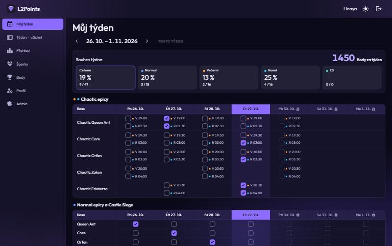 `01-my-week-dark.jpg` | Můj týden dark: vybledlé „Tento týden“ (A1), mřížka a zamčené dny (pozitivní), „1450“ bez mezery (E3) |
| 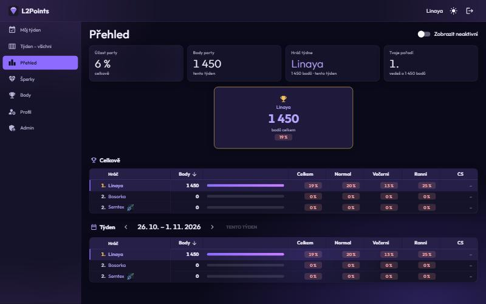 `02-leaderboard-dark.jpg` | Přehled dark: červená zeď „0 %“ (A7), štítky na řádku „já“ (A2), KPI s váhou 300 (B3, E5) |
| 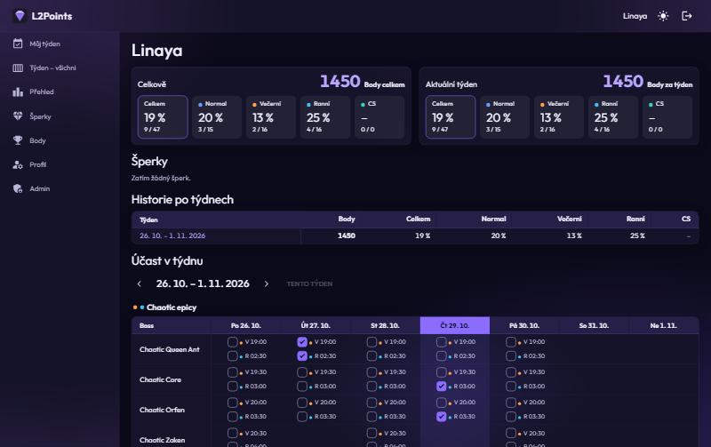 `03-player-detail-dark.jpg` | Detail hráče: nadpisy h5 větší než karty (E2), „1450“ (E3), procenta bez tónu (E4), prázdný stav šperků (F2) |
| 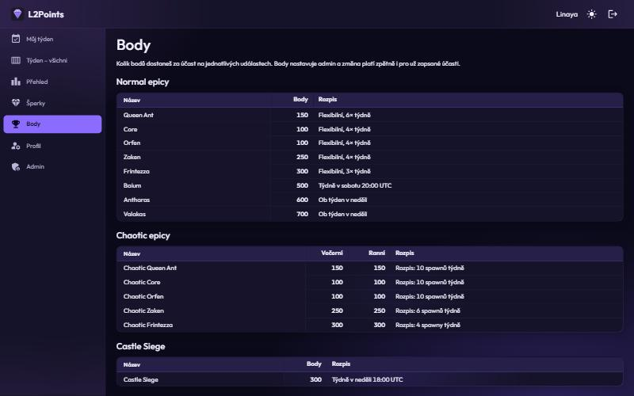 `04-points-dark.jpg` | Body: časy v UTC (E6), sloupce tabulek nelícují (B4), nadpisy h6 (E2) |
| 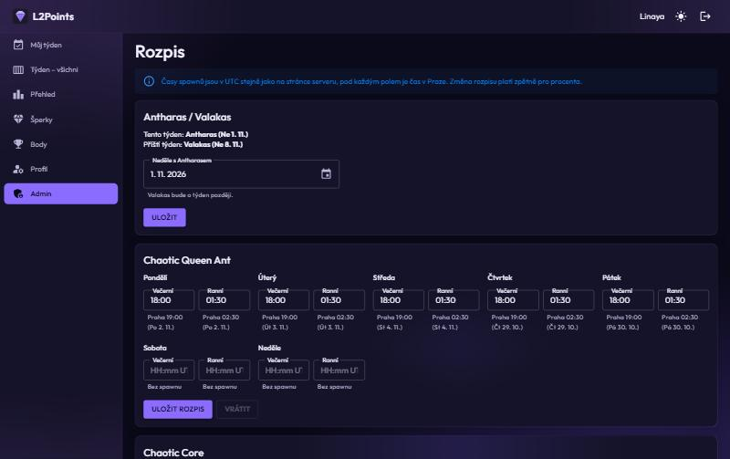 `05-admin-schedule-dark.jpg` | Rozpis: Info alert mimo tokeny (A4), ořezaný placeholder (H7), velká písmena tlačítek (E7) |
| 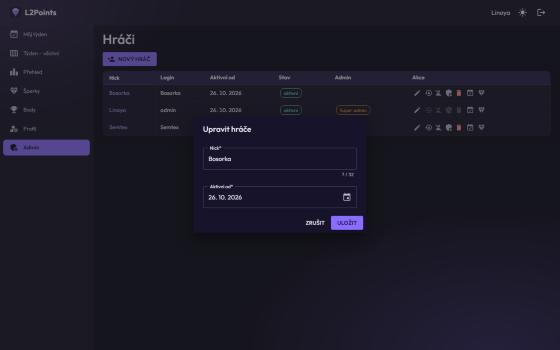 `06-dialog-dark.jpg` | Dialog: radius 4 px a Material stín (D1), 26px admin akce (H2) |
| 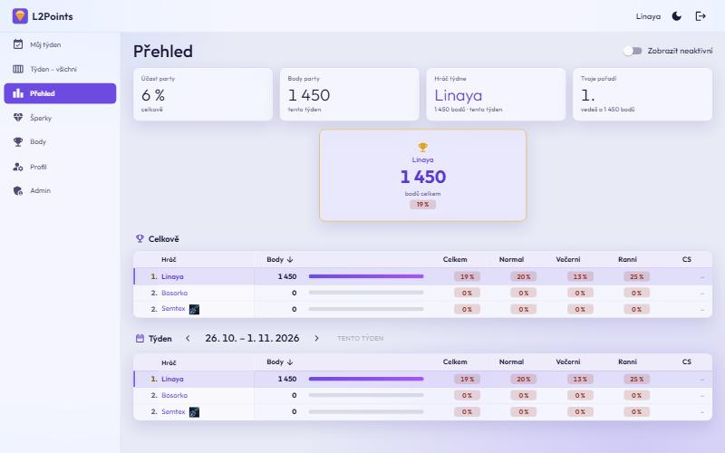 `07-leaderboard-light.jpg` | Přehled light: ikona šperku jako černý čtverec (I1) |
| 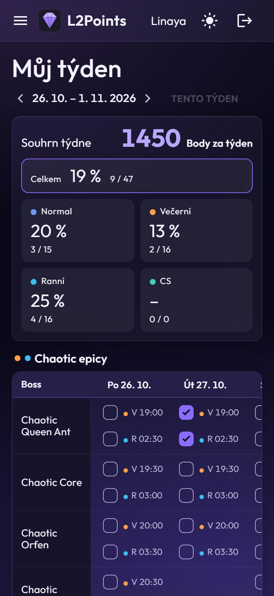 `08-my-week-mobile-dark.jpg` | Můj týden mobil: zaškrtávátka 36 px bez mezery (H1), dnešek mimo obraz (E8), velký titulek (B2) |
| 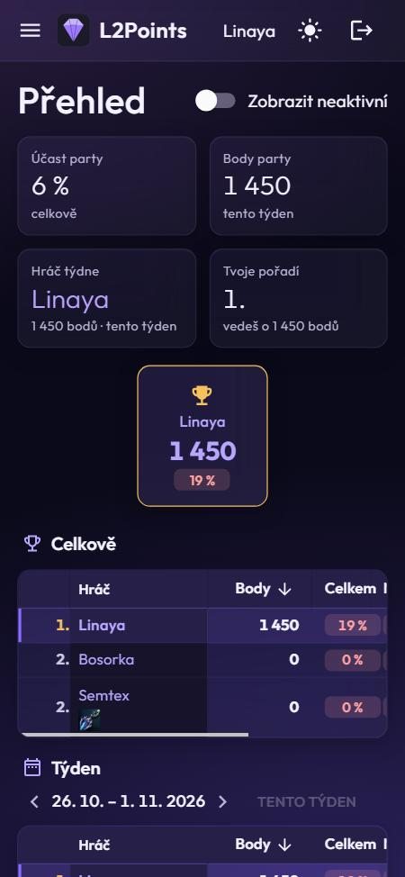 `09-leaderboard-mobile-dark.jpg` | Přehled mobil: tmavý přilepený sloupec (C3), viditelné jen Body a Celkem (H5) |
| 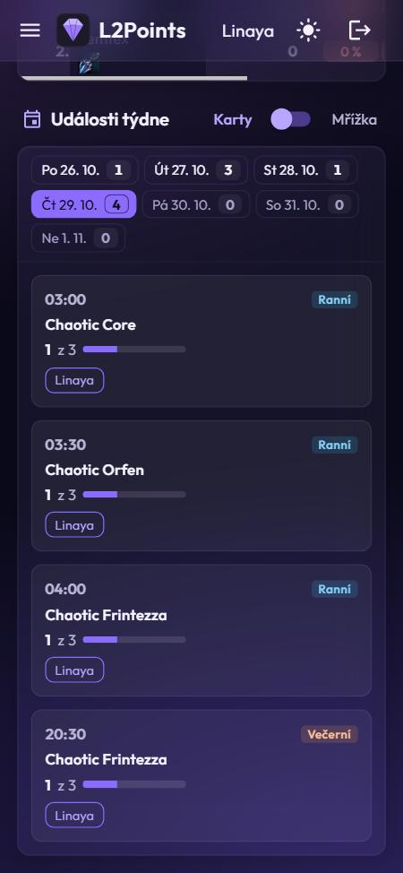 `10-week-events-mobile-dark.jpg` | Události týdne mobil: výběr dne 27 px (H3), karty událostí (pozitivní) |
| 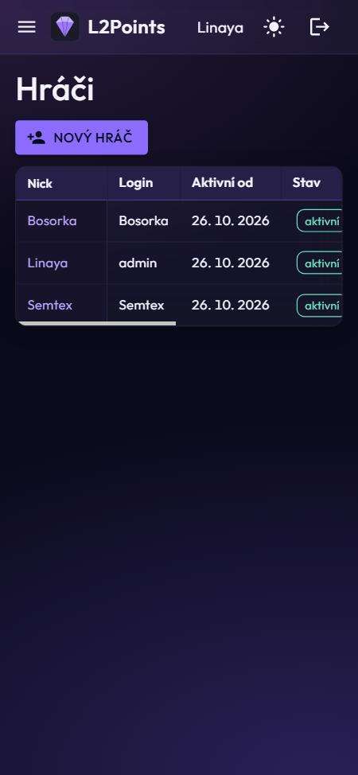 `11-admin-players-mobile-dark.jpg` | Admin hráči mobil: akce úplně mimo obraz (H2) |

## Doporučené pořadí implementace

Pro samostatný plán, každý krok je malý a ověřitelný v běžící appce:

1. **Přístupnost bez změny vzhledu:** globální focus (G1), `<h1>` a úrovně nadpisů (E1), hlavičky sloupců (G2), reduced motion (G4).
2. **Tokeny barev:** řádek „já“ 10 %, tóny, muted, place, sémantické barvy a `AppTheme.cs` včetně testu zrcadlení (A1–A6, A8), plus A7 (neutrální 0 %).
3. **Dotykové cíle:** `(pointer: coarse)` blok (H1, H3, H4), posun na dnešek (E8).
4. **Admin hráči na mobilu:** karty a overflow menu (H2).
5. **Škály rozměrů:** spacing, radius, font, stíny a dialogy (B1–B3, C1, C2, D1, D2), `PageHeader` / `SectionTitle` (B2, E2), sloupce na `/points` (B4).
6. **Obsah a stavy:** formát bodů, tón v historii, pražský čas, texty (E3–E7), skeletony a `EmptyState` (F1–F4), ikony šperků (I1), přilepené buňky (C3), blur na dlaždicích (D3).
7. **Volitelně:** spodní navigace na mobilu (H6), žebříček na mobilu (H5).
